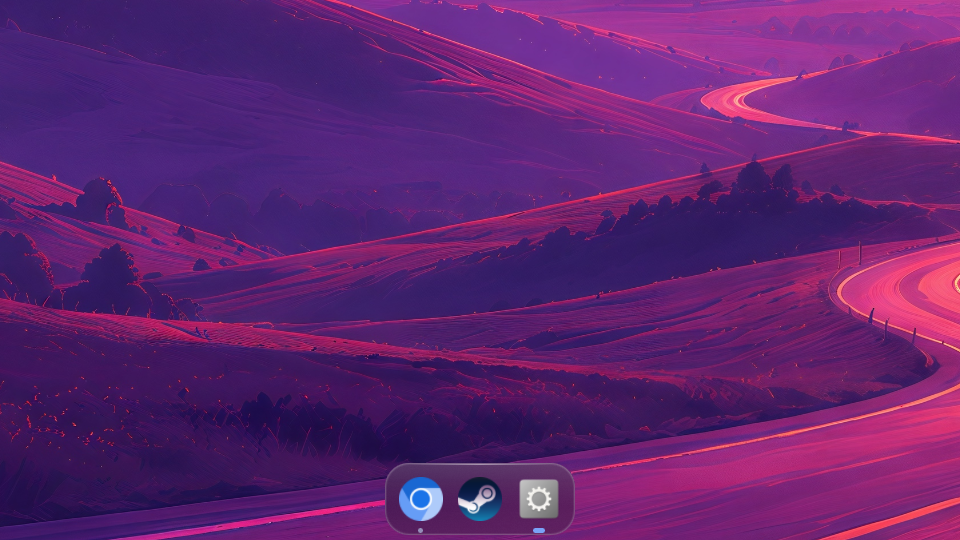

# Glass Dock for Omarchy

A liquid-glass application dock for [Omarchy](https://omarchy.org) (Hyprland +
Quickshell), with per-app **window groups**, **live window previews**, and an
**Alt+Tab switcher** built on the same groups.



- **Two designs.** Pick **Glass** or **Omarchy** in Dock Settings. Omarchy
  draws every surface with the shell's own components and tokens: bar and
  popup colours, the theme's border, and Hyprland's corner rounding. The dock
  then looks like part of the bar.
- **Glass look.** Translucent shelf tinted from your Omarchy theme, real
  Hyprland blur behind it, a specular sheen and a bright rim. It follows
  `omarchy theme set` live.
- **Magnification.** Icons swell under the pointer, macOS style.
- **Window groups.** One icon per app. Dots show how many windows it has. Hover
  for live thumbnails of every window in the group, each with its workspace.
- **Smart clicks.**
  - Left click launches the app or focuses its latest window. Clicking again
    walks through the app's windows.
  - Middle click opens a new window.
  - The mouse wheel cycles through the app's windows.
  - Right click opens a menu: jump to a window, new window, pin or unpin,
    close all.
- **Alt+Tab.** A glass overlay of your apps, most recently used first, with
  live previews. Tab moves between apps, and `` ` `` moves between the selected
  app's windows. Releasing Alt switches.
- **Pinned apps.** Pinned apps sit left of the separator and running apps sit
  right of it. Chromium web apps resolve to their own desktop entries and icons.
- **Multi-monitor.** One dock per monitor, or only the monitors you list.
- **Show on hover.** Optional. The dock stays hidden until the pointer comes
  near it (a configurable area around the dock, not just the dock itself)
  for the show delay, then slides and fades in.
- **Show/hide key.** Super+Alt+D hides or shows the dock, and it stays that
  way after a restart. Pick another key in Dock Settings.
- **Animations toggle.** Turn every animation off for an instant, minimal dock.
- **Overlay mode.** Optional. The dock floats over your windows instead of
  reserving space at the bottom of the screen.
- **Settings window.** A panel with collapsible sections, live controls for
  every option, and your pinned apps. Open it from Super+Space → System → Dock Settings, or from
  any app's right-click menu.

## Requirements

- **Omarchy 4**, with its Quickshell-based shell (`omarchy-shell`, Quickshell
  0.3). Glass Dock runs as a plugin inside it.
- **Hyprland 0.55 or newer**, with the Lua config
  (`~/.config/hypr/hyprland.lua`) that Omarchy 4 uses.

There are no other dependencies and nothing to install from packages. At
runtime the plugin only talks to Hyprland, through its IPC and `hyprctl`.

## Install

```bash
omarchy plugin add https://github.com/JesperFiltenborg/omarchy-glass-dock.git --enable
```

Then hook up blur and Alt+Tab by adding this to the end of
`~/.config/hypr/hyprland.lua`:

```lua
local glassdock = os.getenv("HOME") .. "/.config/omarchy/plugins/jesperfiltenborg.glassdock/hypr/glassdock.lua"
if io.open(glassdock) then dofile(glassdock) end
```

Check it with `hyprctl reload && hyprctl configerrors`.

The snippet does three things:

1. **Turns on Hyprland blur.** Omarchy ships with blur disabled. The snippet
   enables it, then opts every window out with `no_blur`, so your apps look
   exactly as before and only the dock is frosted.
2. **Adds layer rules.** These blur the `glassdock*` layers and disable
   Hyprland's slide-in animation for them.
3. **Replaces Alt+Tab.** It removes Omarchy's `ALT + TAB` (cycle_next) and
   `ALT + SHIFT + TAB`, and binds them, plus `` ALT + ` ``, to the switcher.

To opt out of either part, set a global before the `dofile`:

```lua
glassdock_blur = false     -- manage blur yourself
glassdock_alt_tab = false  -- keep Omarchy's Alt+Tab
```

### Add Dock Settings to the Super+Space menu

Add this line inside the object in `~/.config/omarchy/extensions/omarchy-menu.jsonc`.
It appears under **System**, and the menu reloads on save:

```jsonc
"system.dock-settings": {"icon":"󱂩","label":"Dock Settings","description":"Glass Dock: size, glass, previews, Alt+Tab, pinned apps","aliases":["glassdock","dock"],"action":"omarchy-shell glassdock openSettings"},
```

### Disable or uninstall

| You want | Do this |
| --- | --- |
| Hide the dock for a while | Press the show/hide key (Super+Alt+D), or `omarchy-shell glassdock toggle` |
| Turn Glass Dock off | `omarchy plugin disable jesperfiltenborg.glassdock` (`enable` turns it back on) |
| Remove it | `omarchy plugin remove jesperfiltenborg.glassdock`, then delete the two lines from `hyprland.lua` |

> [!IMPORTANT]
> **Disabling the plugin leaves Alt+Tab doing nothing** until you change
> `hyprland.lua`. A disabled plugin stays on disk, so the snippet still loads
> and still binds Alt+Tab to the switcher, but nothing is running to answer.
> To get Omarchy's Alt+Tab back while the plugin is disabled, either delete
> the two lines or put `glassdock_alt_tab = false` above them, then run
> `hyprctl reload`. Turning off "Use Glass Dock for Alt+Tab" in Dock Settings
> doesn't help here, because the settings window isn't running either.
>
> Removing the plugin doesn't have this problem: the file is gone, so the
> `io.open` guard skips the snippet and Omarchy's Alt+Tab returns after
> `hyprctl reload`. The blur settings go with it too.

The show/hide key is bound by the running plugin, not by `hyprland.lua`, so it
goes away by itself when the plugin is disabled or removed.

## Controls

| Where    | Input                     | Action                                                  |
| -------- | ------------------------- | ------------------------------------------------------- |
| Dock     | Left click                | Launch, focus the latest window, or step to the next one |
| Dock     | Middle click              | New window                                              |
| Dock     | Wheel                     | Cycle the app's windows                                 |
| Dock     | Hover                     | Live previews of the app's windows                      |
| Dock     | Right click               | Menu: windows, New Window, Keep in Dock, Dock Settings…, Close |
| Preview  | Click, middle click or ✕  | Focus, or close the window                              |
| Anywhere | Alt+Tab, Alt+Shift+Tab    | Next or previous app                                    |
| Anywhere | `` Alt+` ``, `` Alt+Shift+` `` | Next or previous window of the selected app        |
| Anywhere | Super+Alt+D               | Show or hide the dock (set by `toggleKey`)              |
| Switcher | ← → ↑ ↓                   | Move between apps and windows                           |
| Switcher | Release Alt or Enter      | Switch                                                  |
| Switcher | Esc                       | Cancel                                                  |
| Switcher | Alt+W or Alt+Q            | Close the selected window                               |

## Configuration

The easiest way to change settings is the **Dock Settings** window: Super+Space
→ System → Dock Settings, "Dock Settings…" in any app's right-click menu, or
`omarchy-shell glassdock settings`. Changes apply instantly. **Reset to
defaults** restores every option but keeps your pinned apps.

Settings live in `~/.config/omarchy/glassdock.json`. The dock creates the file
with defaults on first run and picks up edits immediately.

| Key                            | Default | Meaning                                              |
| ------------------------------ | ------- | ---------------------------------------------------- |
| `pinned`                       | `[]`    | App ids kept in the dock, in order                   |
| `showDock`                     | `true`  | Show the dock; the show/hide key and `toggle`/`show`/`hide` change it, and it survives restarts |
| `toggleKey`                    | `"SUPER + ALT + D"` | Hyprland key combination that shows or hides the dock (`""` for none). Needs Super, Ctrl or Alt, except F-keys |
| `monitors`                     | `[]`    | Output names to show the dock on (empty means all)   |
| `iconSize`                     | `52`    | Icon size in px                                      |
| `magnification`                | `1.55`  | Hover zoom (`1` disables it)                         |
| `magnificationRange`           | `3`     | How many neighbouring icons the zoom reaches         |
| `margin`                       | `10`    | Gap between the dock and the screen edge             |
| `showOnHover`                  | `false` | Hidden until the pointer comes near the dock         |
| `revealArea`                   | `24`    | px above the dock's spot that also reveal it (6× that to each side) |
| `showDelay`                    | `100`   | ms the pointer must stay near a show-on-hover dock before it shows |
| `hideDelay`                    | `600`   | ms before a show-on-hover dock hides again           |
| `overlay`                      | `false` | Float over windows instead of reserving space        |
| `showRunningSeparator`         | `true`  | Divider between pinned and running apps              |
| `animations`                   | `true`  | Animate the dock, previews, switcher and settings window; off makes every change instant |
| `style`                        | `"glass"` | Design: `"glass"` or `"omarchy"` (follows the Omarchy style guide) |
| `glassOpacity`                 | `0.32`  | Tint strength; keep it above the 0.12 blur threshold |
| `glassHighlight`               | `0.14`  | Strength of the top-edge sheen                       |
| `cornerRadius`                 | `24`    | Shelf corner radius                                  |
| `previews`                     | `true`  | Show window previews on hover                        |
| `previewWidth`                 | `240`   | Thumbnail width                                      |
| `previewDelay`                 | `380`   | Hover time before previews open (ms)                 |
| `maxDots`                      | `3`     | Window dots shown per app                            |
| `switcher`                     | `true`  | Use the switcher for Alt+Tab; off falls back to plain window cycling |
| `switcherCardWidth`            | `280`   | Switcher card width                                  |
| `switcherRevealDelay`          | `90`    | ms before the overlay appears; quicker taps switch without it |
| `switcherCurrentWorkspaceOnly` | `false` | Limit Alt+Tab to the current workspace               |
| `switcherDisplay`              | `"focused"` | Where Alt+Tab shows: `"focused"` (current display), `"primary"` (main display) or `"all"` (mirrored on every display) |
| `switcherMainDisplay`          | `""`    | Output name of the main display, e.g. `"DP-3"` (empty means the first display) |

App ids are what `hyprctl clients` reports as `class`. The fastest way to pin
an app is from its right-click menu, or run `omarchy-shell glassdock pinFocused`.

## IPC

```bash
omarchy-shell glassdock <method> [arg]
```

| Method                                 | Description                                       |
| -------------------------------------- | ------------------------------------------------- |
| `next`, `prev`                         | Open the switcher, or step to the next/previous app |
| `nextWindow`, `prevWindow`             | Step through the selected app's windows           |
| `commit`, `cancel`                     | Switch to the selection, or close the switcher    |
| `settings`, `openSettings`, `closeSettings` | Toggle, open or close the settings window    |
| `toggle`, `show`, `hide`               | Show or hide the dock (saved as `showDock`)       |
| `pin <appId>`, `unpin <appId>`, `pinFocused` | Manage pinned apps                          |
| `state`                                | JSON dump of what the dock sees, for debugging    |
| `config`                               | JSON dump of the settings the dock is running with |

The show/hide key (`toggleKey`) is the built-in way to bind `toggle`. The
plugin binds it itself with `hyprctl eval` while the shell runs, and rebinds it
after `hyprctl reload`, so it needs no line in `hyprland.lua`. If you'd rather
bind it yourself, set `toggleKey` to `""` and bind
`omarchy-shell -q glassdock toggle` in your Hyprland config.

## Known limitations

- The dock is bottom-only for now. With Omarchy's bar also at the bottom, the
  dock sits above the bar, so the reveal area is above the bar too.
- With Show on hover and Act as overlay both on, the reveal area lies over
  your windows. Clicks in it (just above the dock's spot) go to the dock, not
  the window. Set Reveal area to 0 to keep that to the dock's own footprint.
- Disabling the plugin without editing `hyprland.lua` leaves Alt+Tab doing
  nothing. See [Disable or uninstall](#disable-or-uninstall).
- A combination Hyprland already binds can't be recorded for the show/hide
  key, because Hyprland handles it before the settings window sees it. That
  usually means it's taken; pick another, or type it into `toggleKey`.
- Alt+Tab can't be exercised with `wtype` or other virtual keyboards, because
  Hyprland ignores their binds. Use the IPC methods to script it.

## Development

The plugin is split into pure logic (`core/lib/`), a data layer (`core/`) and
views (`ui/`). See [docs/ARCHITECTURE.md](docs/ARCHITECTURE.md) for how the
pieces fit and where to extend them. Working with an AI coding agent? Point
it at [AGENTS.md](AGENTS.md). Claude Code also picks up the project skills in
`.claude/skills/`.

```bash
scripts/dev-sync.sh           # copy into ~/.config/omarchy/plugins and restart the shell
scripts/dev-sync.sh --watch   # do that on every save
scripts/dev-tools.sh          # inspect the live dock: layers, screenshots, pointer, logs, IPC
omarchy plugin validate .
```

The script copies the tree and restarts the shell for two reasons. The shell's
hot reload only re-reads the plugin's entry file, so components in `core/` and
`ui/` stay cached until a restart. Its file watcher also doesn't follow
symlinks.

Shell logs: `journalctl --user -f | grep -i glassdock`.

### Tests

```bash
scripts/test.sh            # lint + static checks + unit + Lua tests (what CI runs)
scripts/lint.sh --fix      # apply formatters (biome, stylua, shfmt) and whitespace fixes
scripts/test.sh unit       # node --test tests/unit/
scripts/test.sh lua        # hypr/glassdock.lua against a fake Hyprland
scripts/test.sh static     # qmllint gate, JS/Lua syntax, manifest, debug leftovers
scripts/test.sh e2e        # live smoke test in your Omarchy session
scripts/test.sh e2e --sync # install the working tree first, then smoke test
```

You need Node 20 or newer, Lua 5.4, `qmllint` (from `qt6-declarative`),
`quickshell` (for its QML type info) and `jq`. An Omarchy install already has
all of these except possibly Lua. For linting you also need
`sudo pacman -S --needed shellcheck shfmt stylua luacheck biome`.
`scripts/setup-dev.sh` enables a pre-commit hook that runs lint and the unit
tests.

| Suite      | What it covers |
| ---------- | -------------- |
| **unit**   | The dock's logic in `core/lib/*.mjs`: grouping, most-recently-used order, dock order, click and wheel targets, the Alt+Tab selection and timing rules, app matching (web apps too), names, icons, launch commands, pinned apps, monitors, magnification and the reveal area. Also cross-file contracts: every setting has a default, an adapter property, a README row and a settings control; the changelog matches the manifest version; the Hyprland snippet's paths and IPC target exist. |
| **lua**    | `hypr/glassdock.lua` with a fake `hl`. It checks the blur and layer rules, that Omarchy's Alt+Tab is replaced, what each key sends, the Alt-release arm/disarm cycle, and the opt-out flags. |
| **static** | `qmllint`, failing only on real problems (syntax errors, broken imports of our own files, duplicates, read-only writes), plus `node --check`, `luac -p`, manifest validation and leftover `console.log`. |
| **e2e**    | Drives the installed plugin over IPC and checks through Hyprland. It confirms the plugin loaded, the shell logs are clean, there's one dock per monitor, the settings file matches what the dock runs with, hide and show work, the switcher opens, steps and cancels without moving focus, and the settings window opens and closes. It also checks the Alt+Tab binds and that Hyprland has no config errors. |

GitHub Actions (`.github/workflows/test.yml`) runs `scripts/test.sh` on Arch
for every push and pull request.

To test new logic, put it in a pure function in `core/lib/`, import it from
QML (`import "lib/x.mjs" as X`), and add a test in `tests/unit/`.

## Contributing

Contributions are welcome. See [CONTRIBUTING.md](CONTRIBUTING.md) for the
workflow, [docs/GIT_WORKFLOW.md](docs/GIT_WORKFLOW.md) for branch names,
Conventional Commits and releases, [docs/STYLE_GUIDE.md](docs/STYLE_GUIDE.md)
for code style and linting, and the [Code of Conduct](CODE_OF_CONDUCT.md).

## Credits

Inspired by [rosakodu/omarchy-dock](https://github.com/rosakodu/omarchy-dock).
This is an independent implementation.

## License

[MIT](LICENSE)
